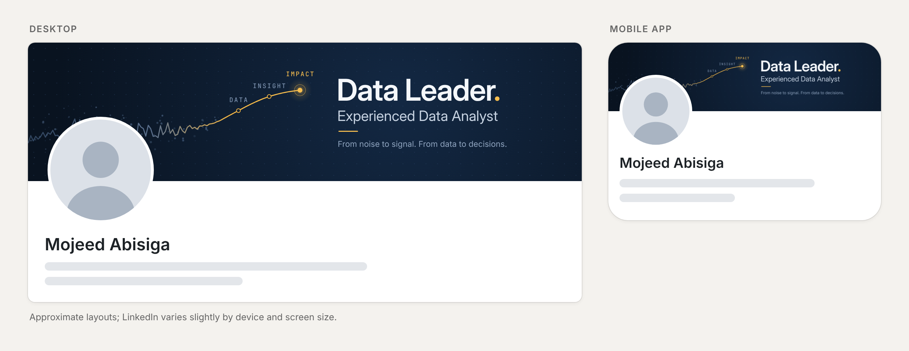

# LinkedIn banner: Data Leader


**`linkedin-banner-1584x396.png`** is ready to upload. It is exactly **1584 × 396 px**, LinkedIn's recommended size for a personal profile background photo (4:1), so it fits LinkedIn's frame with nothing to crop. 297 KB PNG (LinkedIn's limit is 8 MB).

## Upload it

1. Open your LinkedIn profile and click the edit icon (camera or pencil) at the top-right of the banner.
2. Choose to upload a new photo and pick `linkedin-banner-1584x396.png`.
3. The crop box already matches the whole image. Leave the zoom at its lowest setting and click **Apply** (or **Save**).

## The idea

Signal from noise, as an annotated chart. On the left, a jagged slate-blue line and scattered points stand for raw data. The line settles into a clean gold trend that rises through **Data → Insight → Impact** and ends in a highlighted point next to the headline: **Data Leader. Experienced Data Analyst.** The tagline is *"From noise to signal. From data to decisions."* The gold full stop after "Data Leader" repeats the impact point.

The noise is real data. The jagged line follows the `Na_to_K` column of [`drug200.csv`](../drug200.csv) (the decision-tree project), and the scattered points are offset by its `Age` column.

## Where things sit

LinkedIn puts your profile photo over the bottom-left of the banner, and phones trim a little off each side. So the left side holds only decoration, and every word sits inside x 600–1390 and y 48–348. `linkedin-banner-preview.png` shows the banner in approximate desktop and mobile layouts.



## Editing it

- The text is in `banner.html`, in the `<g id="copy">` block. Open the file in Chrome to preview it.
- Add `?guides=1` to the address to see the photo areas (red is the desktop photo, blue the area that can be covered on mobile) and the safe zone for text (green).
- Colours: navy `#091320` → `#132843`, gold `#F7BE4F`, text `#F4F7FB` / `#C7D3E2` / `#8EA3BE`.
- Fonts: Inter Display, Inter and JetBrains Mono, all free on Google Fonts. Install them before exporting, or the text falls back to another font.
- To export again at exactly 1584 × 396:

  ```bash
  npm install playwright && npx playwright install chromium
  ```

  ```bash
  node render.js
  ```
