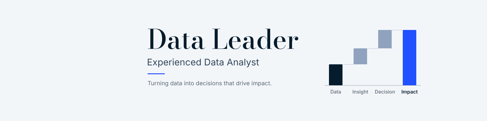

# LinkedIn cover: Data Leader



`linkedin-cover-1584x396.png` is **1584 × 396 px**, LinkedIn's recommended size
for a personal profile background (4:1). It fits the upload frame exactly, so
there's nothing to crop.

**Style.** It's drawn like a strategy-consulting exhibit: a bright off-white
background, a few deep-navy elements, and one electric-blue highlight. The
headline is set in a Bodoni serif, with clean sans-serif text and plenty of
white space. There's no consultancy name or logo on it, so it's your own design.

**The chart** is a waterfall, the classic consulting exhibit: **Data + Insight +
Decision = Impact**. The total, Impact, is the one bar in electric blue,
matching the short rule under the subtitle. The bar heights are illustrative,
not real figures.

**Safe zones.** All text sits between x = 478 and 971 px, clear of the corner
the profile photo covers on both desktop and phone. The chart ends at
x = 1368 px, so everything fits the centre 80% of the width that some phone
layouts show.

## Upload

1. On your profile, click the pencil/camera icon on the background banner.
2. Upload `linkedin-cover-1584x396.png`.
3. Leave zoom and straighten at their defaults, then click Apply and Save.

## Edit and re-render

Change `HEADLINE`, `SUBTITLE`, `TAGLINE`, `STEPS` or the colours in `C` at the
top of the script in `cover.html`, then run:

```bash
node linkedin-cover/render.cjs
```

This needs Node, Playwright with Chromium, and an internet connection, because
the fonts (Bodoni Moda, Inter) load from Google Fonts. To draw the
profile-photo and phone-crop guides on top, run
`node linkedin-cover/render.cjs preview.png --debug`.
