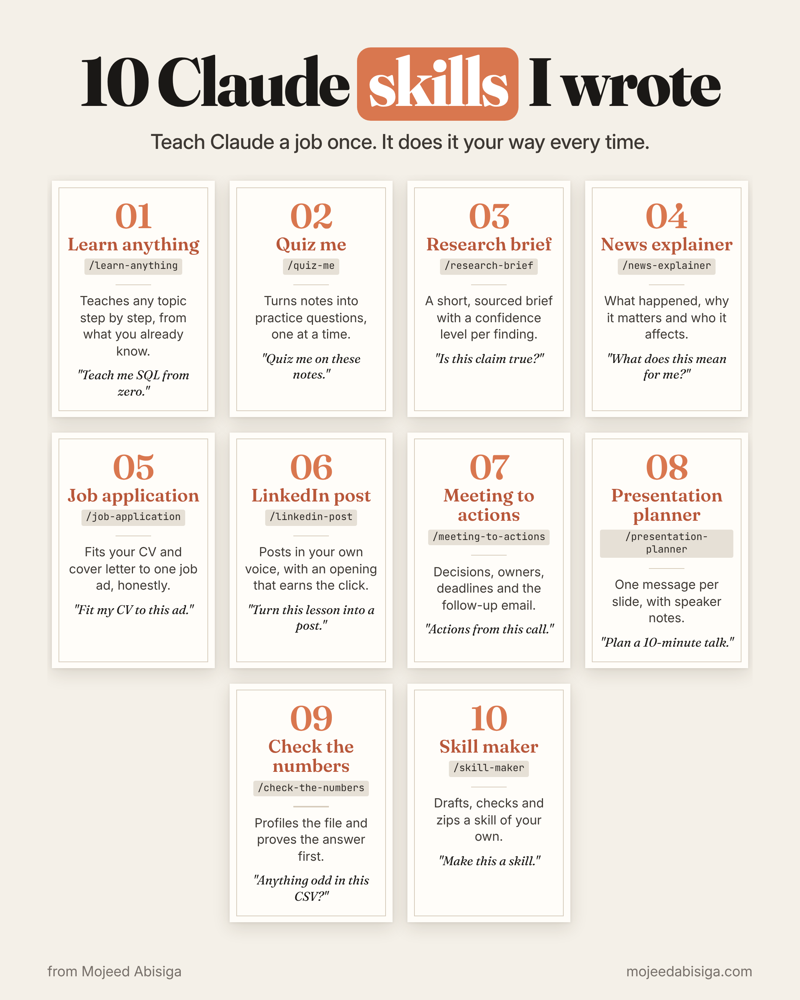
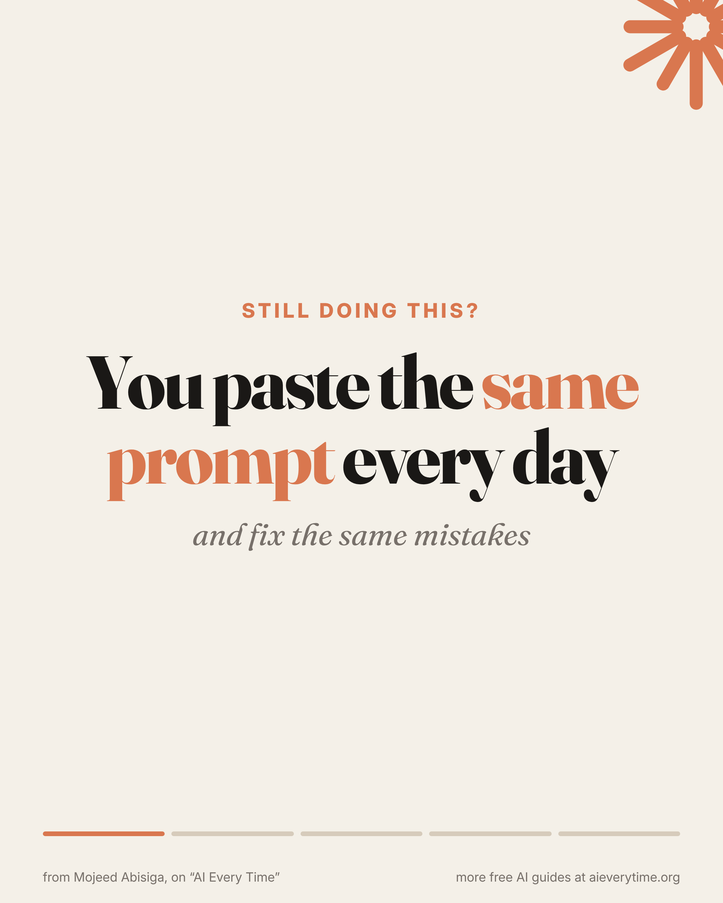
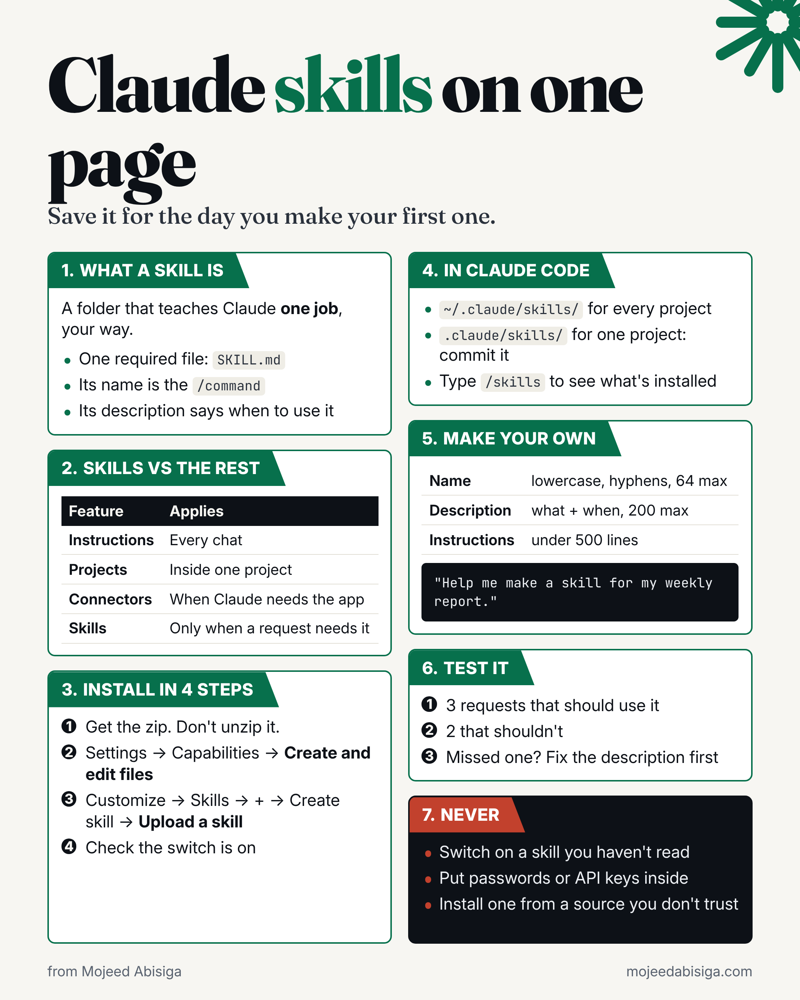

# LinkedIn Post Engine

Writes LinkedIn posts and makes their graphics, as a still image (PNG), an animated GIF or a video (MP4), in a
style it learned from a folder of example posts. Set up for Mojeed Abisiga: every graphic carries his name and site
in its footer, and when a post needs a link, it points to his website,
[mojeedabisiga.com](https://mojeedabisiga.com/).

| Static card grid | Self-drawing whiteboard (GIF) | Kinetic video (MP4) | One-page cheat sheet, brand colours |
|---|---|---|---|
|  |  | [](examples/skills-kinetic-video/graphic.mp4) |  |

Each sample folder in [`examples/`](examples) holds the post text (`post.txt`, `post.md`), the graphic, a
LinkedIn-style `preview.html` and the checks (`report.json`). Every fact in them comes from
[`briefs/skills-starter-kit.json`](briefs/skills-starter-kit.json); each `spec.json` points to that brief, so
`python -m lpe render examples/<name>/spec.json` redraws a sample and re-runs its checks.

## How it learned the style

Training reads a Google Drive folder where each post is a text file and a graphic with the same name
(`Post 3 Text.txt` + `Post 3 Image.jpg`, `Post 20 Text.txt` + `Post 20.gif`). From the 26 posts it was trained on:

- **Measurements** (`lpe/analyze.py`, `lpe/media.py`): length (typically about 2,000 characters, most between
  1,300 and 2,800), line rhythm (70% of lines are 60 characters or less), hooks (half end with a colon that opens
  a list; about half contain a number), lists (88% use numbered or "Step N" lists), bullet glyphs (`>` `☑` `→` `✦`),
  closings, emoji (19% of posts) and hashtags (none). From the graphics: shape (24 of 26 are 4:5 portrait), dark or
  light, motion (one 13-second GIF at 30 fps), and the recurring colours (cream, near-black, terracotta, red).
- **Patterns**, written by hand after reading every post (`lpe/knowledge.py`): 25 hook formulas, 12 body
  structures and 10 closings, abstracted with `[placeholders]` so the engine reuses the shape, never the words.
- **Graphic types** (`training/annotations.json`): what each of the 26 graphics is, mapped to one of 17 templates
  that reproduce those layouts as HTML.

The result is [`model/voice_guide.md`](model/voice_guide.md), a readable style guide that is Claude's brief when it
writes, plus `model/style_profile.json`. When writing a post, the engine also shows Claude the three example posts
closest to the topic (TF-IDF retrieval over `model/corpus.jsonl`). To change a pattern, edit `lpe/knowledge.py`:
the engine reads it on every run, and `python -m lpe guide --write` refreshes the two model files without retraining.

This is in-context learning rather than fine-tuning. Claude models can't be fine-tuned through the API, and 26
examples are put to better use as a style guide plus well-chosen examples at the moment of writing.

**The example posts belong to another creator.** They stay on your machine: `training/data/` and
`model/corpus.jsonl` are git-ignored, and only measurements, patterns and the hand-written annotations are
committed. The engine borrows structure, never wording. Its checks block the creator's name, newsletter and links,
and any run of 12 or more words copied from an example. Two example posts teach readers to have an AI pass course
quizzes for them; they're excluded from the examples Claude sees, and the checks reject that kind of advice.

## Set up

Python 3.10 or later, and ffmpeg for GIF and MP4. Run every command from this folder (the one that contains `lpe/`
and `brand.json`).

```bash
python -m pip install -r requirements.txt
python -m playwright install chromium
```

Train once on each machine. The link is saved in `training/sources.local.json` (git-ignored), so later runs
can drop `--drive`:

```bash
python -m lpe train --drive "https://drive.google.com/drive/folders/<folder-id>"
```

The folder must be shared as "Anyone with the link". The committed style guide works without training, but
Claude then gets no example posts.

## Make a post

**With a Claude API key** (`ANTHROPIC_API_KEY`, or `ant auth login`), the engine does everything:

```bash
python -m lpe generate "Why your AI drafts sound generic" --notes @notes.txt --audience "marketing managers"
python -m lpe generate --brief briefs/skills-starter-kit.json
python -m lpe generate "Pick the right AI tool for the job" --template decision_tree --format mp4
```

It makes two Claude calls: one writes the post, one fills the chosen template. When the checks find errors in
anything you'd publish (the post, the other openings, the alt text, the graphic), Claude gets them back to fix: up
to two repair calls for the writing and one for the graphic. Anything still wrong is listed, and the command exits
with code 2. The default model is set in `lpe/llm.py`. Requests use structured JSON output, adaptive thinking, prompt caching for the style
guide, and Anthropic's server-side fallback (`fallbacks: "default"`), so a declined request is retried on another
model instead of failing. Each run prints its token use and estimated cost. `--model`, `--effort` or the
`LPE_MODEL` and `LPE_EFFORT` variables change the model and thinking effort.

**Without a key, in Claude Code**, ask for a LinkedIn post. The `linkedin-post-engine` skill
([`.claude/skills/linkedin-post-engine/SKILL.md`](.claude/skills/linkedin-post-engine/SKILL.md) in this folder) has Claude write the post from the voice
guide and examples, fill a `spec.json`, then render and check it:

```bash
python -m lpe render output/2026-11-23-my-post/spec.json
```

Either way you get a folder:

| File | What it is |
|---|---|
| `post.txt` | The post, ready to paste |
| `post.md` | The post, two other openings, facts to check before posting, the alt text |
| `graphic.png` | 2160 × 2700 (4:5 at double density), always made |
| `graphic.gif` | Looping animation, kept under 5 MB |
| `graphic.mp4` | H.264, 1080 × 1350, 30 fps |
| `preview.html` | How it looks in the feed, with the "see more" fold where LinkedIn puts it |
| `spec.json` | Everything the graphic was made from: edit it and run `render` again |
| `report.json` | The checks, the fit of the text, motion length, cost |

## Commands

| Command | Does |
|---|---|
| `train [--drive LINK] [--annotate]` | Download the examples, measure them, write the style files. `--annotate` asks Claude to classify posts missing from `annotations.json` |
| `generate TOPIC [--brief F] [--notes T\|@file] [--template T] [--theme T] [--format F]` | Write and render a post with Claude |
| `render SPEC.json [--format F] [--brief F]` | Render and check a post written by hand or by Claude Code |
| `lint POST.txt\|SPEC.json [--fix] [--brief F]` | Check a post, or a whole spec (post, other openings, alt text, graphic). `--fix` replaces em dashes and stray markdown |
| `examples "topic" [--full]` | The training posts closest to a topic |
| `templates [NAME] [--sample]` | List templates, or show one's fields and an example |
| `themes` / `guide [--write]` | List colour themes / print the voice guide (`--write` saves it after editing `lpe/knowledge.py`) |

`--format` is `auto` (the writer's or the template's choice), `png`, `gif`, `mp4`, `all`, or a list such as
`png,mp4`. A PNG is always made.

## Templates

Each reproduces a layout from the training set. All of them can animate: elements build in order, and paths and
connectors draw themselves.

| Template | Looks like | Learned from | Usual format |
|---|---|---|---|
| `cheatsheet` | The whole guide on one page: panels with steps, tables, prompts | Posts 3, 10, 21 | PNG |
| `link_list` | Guides or tips: `pinned` red pins, `notes` phone app, `terminal`, `doc` | Posts 4, 15, 18, 24 | PNG |
| `prompt_ladder` | Bad, better, best prompt in chat boxes | Post 13 | PNG |
| `prompt_anatomy` | One prompt coloured by delete / keep / add | Post 7 | PNG |
| `split` | Two opposing lists: delete vs keep | Posts 8, 23 | PNG |
| `funnel` | What to avoid, narrowing into what to do instead | Post 17 | PNG |
| `glossary` | Numbered terms in two columns | Post 9 | PNG |
| `roadmap` | A winding path of numbered stops to a finish box | Posts 5, 16 | PNG |
| `cycle` | Cards in a loop around one big number | Post 25 | PNG |
| `mindmap` | A hub with branches; `whiteboard` draws itself by hand | Posts 14, 20 | GIF |
| `decision_tree` | Yes/no questions down to four answers | Post 26 | MP4 |
| `card_grid` | Tools or skills as cards, or features with labelled facets | Posts 11, 22 | PNG |
| `big_number` | Bars and huge figures. Only with real numbers and a source | Post 6 | MP4 |
| `badge` | One bold title on a shape | Post 19 | PNG |
| `bookshelf` | A reading list as cloth book spines | Post 12 | PNG |
| `kinetic` | A short video: one idea per scene, words popping in | (new: motion graphics) | MP4 |
| `screenshot_callout` | Sticker captions and red boxes on your own screenshot | Posts 1, 2 | PNG |

Text on graphics is sized automatically to fill the space without overflowing, and the render reports anything
that still doesn't fit. Inside fields, `*word*` uses the accent colour, `**word**` bold, `==word==` a marker
highlight, `[[word]]` an accent pill, `__word__` a red underline, `` `code` `` a chip.

## Brand and colours

[`brand.json`](brand.json) holds the author's name and headline, the website (`site` as shown on graphics, `url`
as linked in posts, `pages` for the site's other real pages), the footer credit, call-to-action lines, voice notes
and the photo for the feed preview (`assets/avatar.webp`). Graphics are signed "Mojeed Abisiga" in the footer, and
posts that need a link use https://mojeedabisiga.com/. `never_mention` lists names that must never appear (now
"AI Every Time", aieverytime.org and aieverytime): Claude is told to avoid them, and the checks reject them in any
spelling ("AI Everytime", "AI-Every-Time", "aieverytime.org") wherever a reader would see them. The same words used
as ordinary prose ("ask AI every time you draft") only get a warning. Edit the list if that changes.

`theme` decides the colours. `learned` keeps each template's look from the training set (cream and terracotta,
white, near-black, whiteboard); a theme name forces it on every post. Themes: `cream`, `paper`, `ink`, `notes`,
`whiteboard`, `terracotta`, and `mojeed` / `mojeed-dark` in the emerald and gold of mojeedabisiga.com (see the
cheat-sheet sample). Override one post with `--theme`.

## Checks on every post

`lpe/guardrails.py` runs after writing (and `generate` repairs errors before rendering). The post gets every check;
the other openings, the alt text, the graphic brief and the graphic itself get the name, link and integrity checks.

- **Errors**: over LinkedIn's 3,000 characters; markdown that would show as symbols; the training creator's
  name, newsletter or sites; any spelling of a name in the brand's `never_mention` list; a `lnkd.in` link that isn't
  in the brief; 12 or more words copied from an example post; advice to have AI pass tests or certifications, or to
  fool recruiters; a chart without a source.
- **Warnings**: AI giveaways ("delve", "seamless", "It's not X, it's Y", em dashes); an opening past the "see more"
  fold; engagement bait; too many hashtags or emoji; unfilled `[CHECK: ...]` placeholders; links not in the brief;
  a page on the author's site that isn't in `brand.json`'s `pages`; ordinary words that read like a `never_mention`
  name.
- **Notes**: numbers that aren't in the brief, to verify before posting.

Facts, numbers, quotes and links come only from the brief. Where a post needs one that isn't there, Claude writes
`[CHECK: ...]` instead of inventing it.

## Add more training posts

Add new pairs to the Drive folder and run `python -m lpe train --annotate` (with an API key, Claude classifies the
new graphics), or describe them yourself in `training/annotations.json`. Set `"use_as_example": false` on a post
whose content you don't want imitated; its measurements still count.

## How it's built

```
linkedin-engine/
  .claude/skills/      the Claude Code skill (linkedin-post-engine)
  lpe/                 the engine (python -m lpe)
    train.py           download, pair, measure, write the style files   drive.py, dataset.py, analyze.py, media.py
    knowledge.py       hook formulas, structures, closings, rules       profile.py renders the voice guide
    retrieval.py       closest example posts (TF-IDF)
    prompts.py llm.py  the Claude calls                                  pipeline.py ties it together
    templates.py       template schemas, samples and layout maths        render.py: Chromium + ffmpeg
    guardrails.py      the checks                                        preview.py: feed preview
  templates/           HTML/CSS for each template, base.css, runtime.js (auto-fit text, motion timeline)
  assets/              avatar.webp (feed preview), icons/, fonts/: Fraunces, Inter, JetBrains Mono, Anton, Kalam,
                       Caveat (SIL Open Font License, see fonts/licenses/)
  model/               voice_guide.md, style_profile.json (committed); corpus.jsonl (local)
  training/            annotations.json (committed); data/ and sources.local.json (local)
  briefs/ examples/    a sample brief and four rendered sample posts
  tests/               python -m pytest
```

Graphics are HTML pages rendered by headless Chromium. Motion uses CSS animations that are paused and moved to
each frame's exact time, so every frame is sharp and every render is identical; ffmpeg then encodes the frames.
The tests run Claude calls through the real Anthropic SDK over a mock connection, so they need no key. They also
render every template in Chromium, and skip those renders when Chromium isn't installed.
